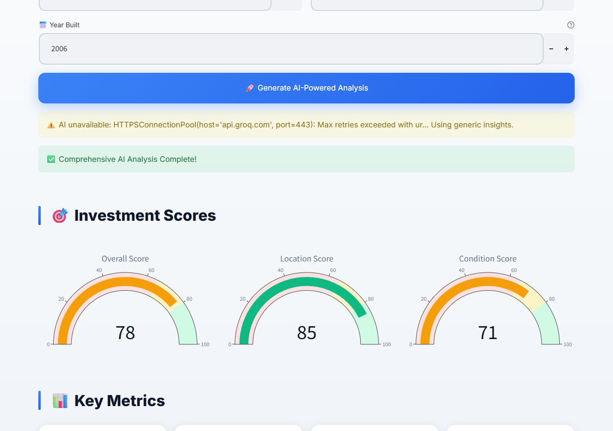
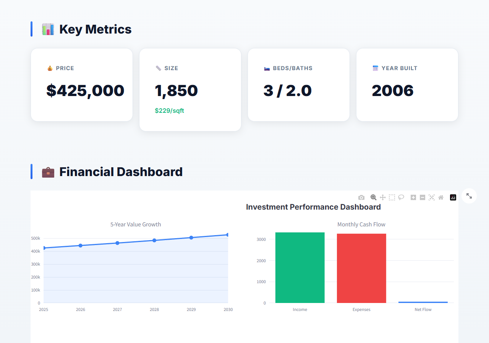
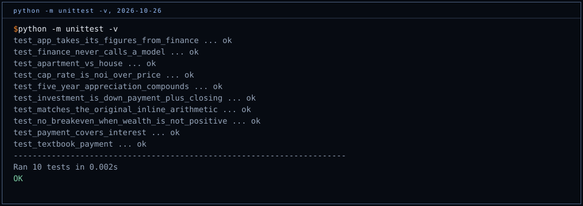

# Real Estate AI Analyzer

[](https://github.com/cadi27tech/real-estate-ai-analyzer/actions/workflows/test.yml)

A Streamlit app that turns a property's price, size and location into an investment report: mortgage payment, cash flow, cap rate, cash-on-cash return and a five-year projection, with market notes from a language model. Houses or apartments, in USD, EUR, GBP or RON, with a square metre to square foot converter.

**[Live demo](https://real-estate-ai-analyzer.streamlit.app/)** (Streamlit Community Cloud; a sleeping app takes a few seconds to wake)





## How it works

<picture>
  <source media="(max-width: 600px)" srcset="docs/architecture-m.svg">
  
</picture>

Numbers are computed, words are generated. Every payment, yield and return comes from [`finance.py`](finance.py), plain arithmetic with no model in the loop. The model (Llama 3.3 70B on Groq, asked for JSON) only supplies market context: median values, employment, neighbourhoods and the appreciation rate used for the projection. If the call fails or returns something that is not JSON, the app says so on screen and falls back to generic figures.

## Assumptions

The model is these numbers. They live in `ASSUMPTIONS` in `finance.py`, and the report changes when they do.

| Assumption | Value |
|---|---|
| Monthly rent estimate | 0.85% of price |
| Loan | 80% of price, 7% fixed, 30 years |
| Down payment and closing costs | 20% and 3% of price |
| Property tax | 1.2% of price a year |
| Insurance | 0.4% (apartment) or 0.6% (house) of price a year |
| HOA | 250 a month (apartment) or 10 (house) |
| Maintenance | 0.5% (apartment) or 1% (house) of price a year |
| Vacancy | 8% of rent |

## Known limits

- Rent is estimated from the price, not entered, so the cash flow is only as good as the 0.85% rule for that market.
- First-year interest is approximated as principal times rate, slightly above the amortised figure.
- Market notes are model output, labelled as estimates in the report. They are not verified data, and the appreciation rate in the five-year table comes from them (or a 4.4% fallback).
- Scores (overall, location, condition) are simple heuristics on age, price and size.

## Tests



`python -m unittest -v` runs 10 tests on the arithmetic: a textbook mortgage payment, golden values captured from the original inline code before it moved into `finance.py`, apartment against house, cap rate as NOI over price, compounding, the no-breakeven case, and two boundary checks: `finance.py` imports nothing at all, and `app.py` takes its figures from it. CI runs them on every push.

## Run it locally

```bash
python -m venv .venv && . .venv/bin/activate   # Windows: .venv\Scripts\activate
pip install -r requirements.txt
mkdir -p .streamlit && echo 'GROQ_API_KEY = "your-key"' > .streamlit/secrets.toml   # optional; without a key the app uses generic market notes
streamlit run app.py
```

`.streamlit/secrets.toml` is git-ignored. `GROQ_API_KEY` can also come from the environment.

## History

Built in October 2025 as an early LLM product demo. In October 2026 the arithmetic moved out of the report template into a tested module, the report started labelling model output as estimates, and the app stopped crashing when no secrets file is present.

## Author

**Adrian Capraru**, Head of AI & Automation. [cadi27tech.github.io](https://cadi27tech.github.io) / [LinkedIn](https://www.linkedin.com/in/adriancapraru27/) / [GitHub](https://github.com/cadi27tech)

MIT licence.
